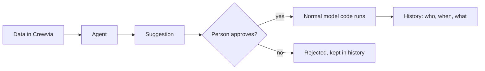

# Agent layer (design)

!!! note "Status"
    Designed, not built. This page records the decisions so the build is consistent.

An **agent** prepares work for a person. It does not act on its own. A person looks at
what it prepared and approves or rejects it.

## The idea in one line

Suggestion, then approval, then history.

## Principles

| Principle | What it means |
|---|---|
| Same rules as a person | An agent sees only its own company's data and is limited by the same permissions |
| Approval first | Nothing is sent to a customer or changes money without a person's approval |
| No new path to the data | Approving a suggestion runs the same model methods a person's click would, so every rule and history entry still applies |
| Nothing deleted | Rejected and expired suggestions stay on record |
| Measured | Each run records what it used and what it cost |
| Earned autonomy, later | An action type may become automatic only after a company has approved it many times, and only if that company switches it on |

## First agents, in order

| Agent | What it prepares | Needs |
|---|---|---|
| **Payment follower** | A reminder email for each overdue invoice, with the amount and the PDF | Invoices and email (built) |
| **Quote drafter** | A draft estimate from a lead's description, using the price list | Price list |
| **QA pre-checker** | Flags a finished job that looks incomplete before a person reviews it | Completed jobs with notes |
| **Dispatch suggester** | Proposed technician and time for an unscheduled work order | Schedule and visit history |
| **Renewal planner** | Reminders for equipment or plans coming due | Equipment and service plans (second trade) |

## Building blocks

- **Suggestion**: which agent, what it proposes, the record it relates to, a status (pending, approved, rejected, expired) and who decided.
- **Agent setting**: per company, whether an agent is on and any limits.
- **Provider**: the part that produces the proposal. It starts as plain rules (keyword matching, date checks). A language model can replace it behind the same interface, with a monthly spending cap and a log of each call.
- **Inbox screen**: where a person reviews pending suggestions.

## Guardrails

- A model's output is a proposal. It is checked against the same validation as a form before anything is saved.
- Customer data sent to an outside provider is limited to what the task needs, and that provider is named in the security baseline before it is used.
- Every agent can be turned off per company.
- A runaway cost or error rate pauses the agent and shows a banner.

## Not in this design

Agents that act with no approval, agents that talk to customers directly, and
agents that read data across companies.
