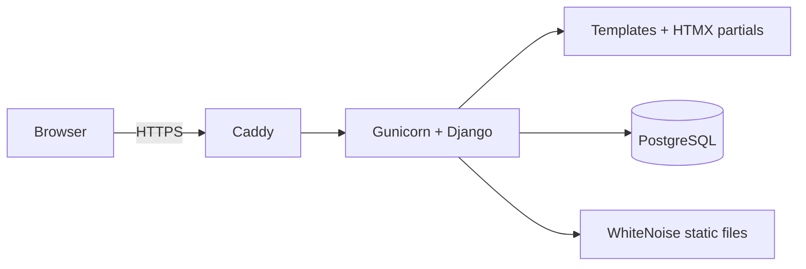

# Architecture

MonsterOS is a **modular monolith**: one Django project, one database, one
deployable unit. This suits a small team and a short timeline, and it can be
split later if it ever needs to be.

## Request flow



In local development the Django development server replaces Caddy and Gunicorn,
and Docker Compose runs the app and the database together.

## Project layout

```text
app/
  config/            settings (base, dev, prod), urls, wsgi
  apps/
    core/            base models, permissions, navigation, dashboard
    companies/       Company (the tenant)
    accounts/        custom User, login, logout, password reset
    (customers, sales, jobs, billing are added in Milestone 2)
  templates/         base.html, dashboard.html, accounts/
  static/            Tailwind source and compiled CSS
docs/                this documentation
infra/               Dockerfile and deployment files
```

## Key design decisions

| Decision | Why |
|---|---|
| Custom user model from the first migration | Changing the user model later is painful. Done before any migration. |
| Every business table carries `company` | Multi-tenant data separation from day one, even though one company uses it first. |
| Audit fields on every table | `created_at`, `updated_at`, `created_by`, `updated_by` through an abstract base. |
| Permissions per action, not per role | Code checks `core.estimates_approve`, never "is admin". Roles are bundles of permissions. |
| Roles defined in code | `apps/core/permissions.py` is the single source of truth, applied with `seed_roles`. |
| Server-rendered pages with HTMX | One codebase and language, no separate front-end build or API needed for the MVP. |
| Tailwind standalone CLI | Styling without a Node toolchain. |

## Multi-tenancy

- `Company` is the tenant.
- Every normal `User` belongs to one company. Platform superusers have none.
- Business models inherit `TenantModel`, which adds a required `company`.
- Views use `CompanyScopedMixin`, which filters querysets to the signed-in
  user's company and stamps audit fields on save.
- A test proves that company A cannot see company B's data.

## Out of scope for now

Live GPS and routing, AI recommendations, accounting integration, customer
portal, online payments, PDF invoices, email and SMS notifications, offline
mode, photo and signature capture.
