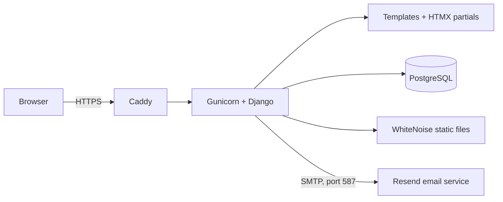

# Architecture

Crewvia is a **modular monolith**: one Django project, one database, one
deployable unit. This suits a small team and a short timeline, and it can be
split later if it ever needs to be.

## Request flow



In local development the Django development server replaces Caddy and Gunicorn,
and Docker Compose runs the app and the database together.

## Project layout

```text
app/
  config/            settings (base, dev, prod), urls, wsgi
  apps/
    core/            base models, permissions, navigation, dashboard
    companies/       Company (the tenant)
    accounts/        custom User, login, logout, password reset, user management
    customers/       customers, contacts, sites
    sales/           leads, estimates and lines
    workorders/      work orders, tasks, visits, scheduling, technician view, QA
    billing/         invoices, lines, payments, PDF and email
    timetracking/    shifts, clock in and out, timesheets, CSV export
  templates/         base.html, dashboard.html, one folder per app
  static/            Tailwind source and compiled CSS
docs/                this documentation
infra/               Dockerfile, entrypoint, Caddyfile, backup and restore scripts
```

## Key design decisions

| Decision | Why |
|---|---|
| Custom user model from the first migration | Changing the user model later is painful. Done before any migration. |
| Every business table carries `company` | Multi-tenant data separation from day one, even though one company uses it first. |
| Audit fields on every table | `created_at`, `updated_at`, `created_by`, `updated_by` through an abstract base. |
| Permissions per action, not per role | Code checks `core.estimates_approve`, never "is admin". Roles are bundles of permissions. |
| Roles defined in code | `apps/core/permissions.py` is the single source of truth, applied with `seed_roles`. |
| Server-rendered pages with HTMX | One codebase and language, no separate front-end build or API needed for the MVP. |
| Tailwind standalone CLI | Styling without a Node toolchain. |
| Users are deactivated, never deleted | History and audit fields keep pointing at a real person. |
| One role per user, at least one active Admin | Keeps the permission picture simple and prevents lock-out. |

## Multi-tenancy

- `Company` is the tenant.
- Every normal `User` belongs to one company. Platform superusers have none.
- Business models inherit `TenantModel`, which adds a required `company`.
- Views use `CompanyScopedMixin`, which filters querysets to the signed-in
  user's company and stamps audit fields on save.
- A test proves that company A cannot see company B's data.

## Outgoing email

Email leaves through one place: Django's mail settings, set from environment
variables. Locally it prints to the console; on staging it goes to Resend over SMTP.
Code that sends mail records every attempt, so a failure is visible and the data
changes made with it are rolled back. See [Email delivery](email.md).

## Installable app

The site serves a web app manifest, icons and a small service worker, so phones can
install it to the home screen. The worker is network-only and caches no data. Native
apps are a later decision; background location needs one. See [Time tracking](timetracking.md).

## Planned: agent layer

A separate app, `agents`, will let software prepare work (a draft quote, a payment
reminder) that a person approves. Agents use the same permissions and company
isolation as people, and approving runs the normal model code, so history and
rules still apply. See [Agent layer](agents.md).

## Out of scope for now

Live GPS tracking and routing, accounting integration, customer portal, online payments,
SMS notifications, a background job queue, offline mode, photo and signature
capture. AI features are planned as the agent layer above.
