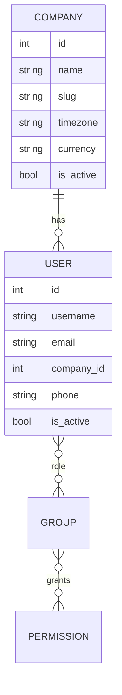

# Data model

Current state after Day 3. Milestone 2 adds the workflow tables.

## Base classes

| Class | Adds |
|---|---|
| `AuditModel` | `created_at`, `updated_at`, `created_by`, `updated_by` |
| `TenantModel` | Everything in `AuditModel`, plus a required `company` |
| `Access` | A table-less model that holds the app permission codenames |

## Planned for Milestone 2

Customer, Contact, Site, Lead, Estimate and EstimateLine, WorkOrder, Visit,
Invoice and Payment. Planned future-proofing fields: `division`, `lead_source`,
site `latitude` and `longitude`, and nullable `external_id` fields for later
accounting sync.
