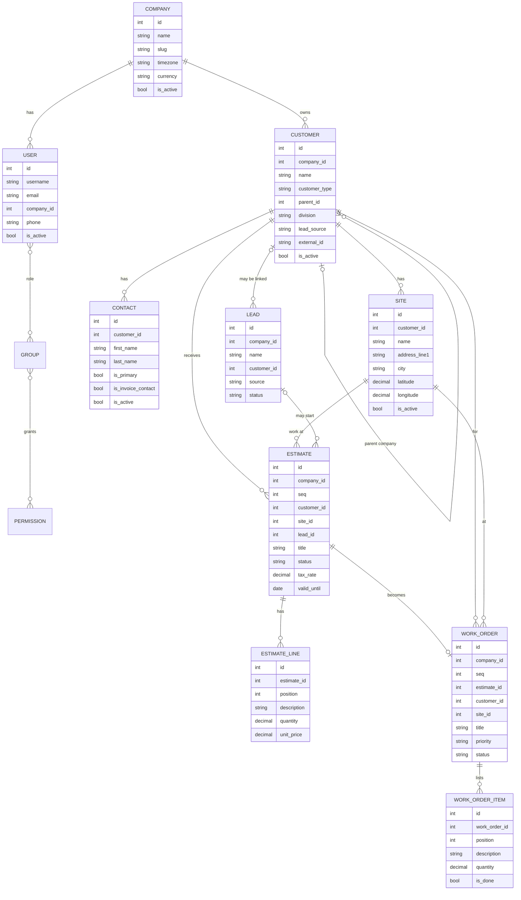

# Data model

Current state after Day 8. The rest of the Milestone 2 workflow tables are added as they are built.

Every field is described on the [Data dictionary](data-dictionary.md).

## Base classes

| Class | Adds |
|---|---|
| `AuditModel` | `created_at`, `updated_at`, `created_by`, `updated_by` |
| `TenantModel` | Everything in `AuditModel`, plus a required `company` |
| `SequencedModel` | Everything in `TenantModel`, plus a per-company `seq` that gives records a readable number such as EST-0001 |
| `Access` | A table-less model that holds the app permission codenames |

## Rules the data follows

- Every business row has a `company`, and a user only ever sees their own company's rows.
- Contacts and sites copy their `company` from their customer, so they cannot drift apart.
- Nothing is deleted. Customers, contacts and sites are deactivated, and the history tables keep every change. The one exception is a line on a draft estimate, which can be removed; the history table still keeps it.
- Estimate and work order numbers (EST-0001, WO-0001) count up separately for each company.
- A work order is made from one approved estimate and carries no prices, so the crew and dispatch never see them. Totals are worked out from the lines and never stored, so they cannot drift.
- A customer's parent company must be in the same company and can never create a loop.

## Planned next

Visit (scheduling), Invoice and Payment.
Invoices and estimates will keep Bill To, Payer, Service Location and Invoice
Contact as separate links, so a head office can pay for a branch's work. Already
in place on the customer side: `parent`, `division`, `lead_source`, site
`latitude` and `longitude`, and nullable `external_id`.
