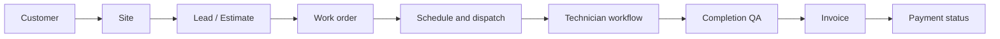

# MonsterOS

MonsterOS is a field service management (FSM) web application for a security
systems installation company. It digitizes the path from first customer contact
to invoice and payment tracking.

## Delivery plan

| Milestone | Scope | Target |
|---|---|---|
| **1 - Foundation** | Login, company and user structure, roles and permissions, navigation and dashboard shell, database foundation, technical documentation | Oct 17 |
| **2 - Core workflow** | Customers, sites, leads and estimates, work orders, scheduling and dispatch, technician workflow, completion QA, invoice and payment status | Nov 1 |

## The workflow being built

## Where to start

- New to the project: [Local setup](setup.md), then [Architecture](architecture.md).
- Looking for a library or tool: [Technology and libraries](technology.md).
- Who can do what: [Roles and permissions](permissions.md).
- What happened and when: [Build log](daily/index.md).
- What is next: [Roadmap](roadmap.md).

!!! note "Scope"
    Milestone 1 and 2 scope is defined by the project agreement. Longer-term
    ideas are listed on the [Roadmap](roadmap.md) and do not expand that scope.
