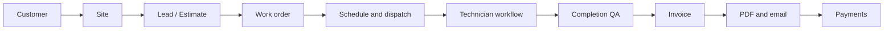

# Crewvia

Crewvia is a field service management (FSM) web application. It follows a job from
the first customer contact to a paid invoice: customers, sites, leads and estimates,
work orders, scheduling, the technician's visit, completion QA, and invoicing with
PDF and email. It is built first for a security systems installer, as one trade pack
on a platform meant to serve other field trades later.

## Where it stands

| Area | State |
|---|---|
| Milestone 1 - Foundation | Built. Staging backup restore still to be tested |
| Milestone 2 - Core workflow | Built end to end, 295 automated tests passing |
| Staging | Live at `https://staging.crewvia.net` with HTTPS and real outgoing email |
| Production | Not yet. See [Production readiness](production-readiness.md) |
| Next | Making it usable with real data (import, price list), then the [agent layer](agents.md) |

## The workflow

## Where to start

- New to the project: [Local setup](setup.md), then [Architecture](architecture.md).
- Looking for a library or tool: [Technology and libraries](technology.md).
- Who can do what: [Roles and permissions](permissions.md).
- Running it on a server: [Staging server](staging.md) and [Deployment](deployment.md).
- Email: [Email delivery](email.md).
- Where the product is going: [Product direction](direction.md) and [Agent layer](agents.md).
- What happened and when: [Build log](daily/index.md).
- What is next: [Roadmap](roadmap.md).

!!! note "Scope"
    Milestone 1 and 2 scope is defined by the project agreement. Longer-term
    ideas are listed on the [Roadmap](roadmap.md) and do not expand that scope.
