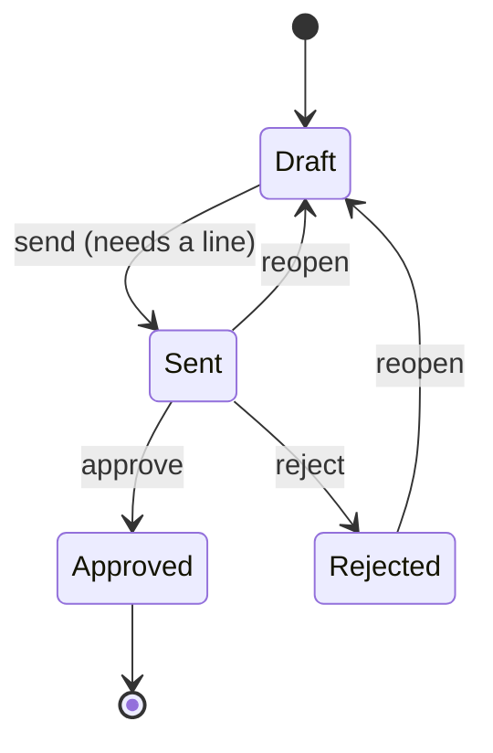

# Leads and estimates

The sales side of Milestone 2. A lead is an enquiry. An estimate is the priced
proposal that follows it. Work orders are created from approved estimates (see
[Work orders](workorders.md)).

## Who can do what

| Role | Leads | Estimates |
|---|---|---|
| Admin | View, add, edit | View, add, edit, send, approve, reject, reopen |
| Office/Sales | View, add, edit | View, add, edit, send, reopen |
| Dispatcher, Finance, Technician | No access | No access |

These follow the existing [permissions](permissions.md); no new permissions were added.
Approving is limited to Admin for now. Say if Office/Sales should record approvals too.

## Screens

| Screen | Address | What it does |
|---|---|---|
| Lead list | `/sales/leads/` | Search, filter by status (Open by default). "Create estimate" per row |
| Add and edit lead | `/sales/leads/new/`, `/sales/leads/<id>/edit/` | The lead form |
| Estimate list | `/sales/estimates/` | Search by title or customer, filter by status, totals shown |
| Estimate detail | `/sales/estimates/<id>/` | Details, lines, totals and the status buttons |
| New and edit estimate | `/sales/estimates/new/`, `.../edit/` | Draft estimates only |
| Lines | under an estimate | Add, edit, remove. Draft estimates only |

## Estimate life cycle

- Only a **draft** can be edited. Once sent, the lines and prices are locked so the customer's copy never changes quietly. Reopen it to change it.
- **Approved is final.** It is the trigger for a [work order](workorders.md): an approved estimate shows a Create work order button, once.
- Every change records who did it and when, plus the sent and decided dates.

## How it behaves

- **Numbers.** Estimates are numbered EST-0001, EST-0002 and so on, separately for each company. Two people saving at once cannot get the same number.
- **Totals.** Subtotal is the sum of quantity times unit price. Tax is the rate applied to the subtotal, rounded to the cent. Totals are never stored.
- **Site and customer.** The site must belong to the chosen customer. Choices only include your own company's records.
- **Lead to estimate.** "Create estimate" starts a draft for the lead's customer, using the customer's first active site, and moves the lead to Estimate sent. The lead needs a linked customer first. Approving the estimate marks the lead Won.
- **Company scoped.** Another company's leads and estimates return "not found".
- **Change history** on leads, estimates and lines. Removing a draft line keeps its history.

## Not included yet

Sending the estimate by email, a printable PDF, customer-facing approval, deposits,
price book or templates, discounts, and converting an unknown lead into a customer
in one step.
